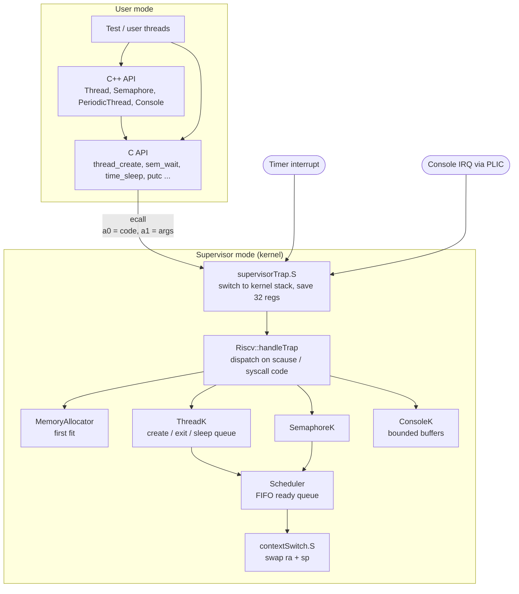

# os1: a small preemptive kernel for RISC-V

[](https://github.com/djokerg/os1/actions/workflows/ci.yml)

A multithreaded kernel for a 64-bit RISC-V machine, written from scratch in C++ and assembly with
no standard library. It boots in QEMU and provides threads, semaphores, sleeping, a heap allocator
and an interrupt-driven console, exposed to user code through both a C and a C++ API.

Built as the semester project for **Operating Systems 1** at the School of Electrical Engineering,
University of Belgrade.

```
xv6 kernel is booting

Unesite broj proizvodjaca?               <- "number of producers?"  3
Unesite velicinu bafera?                 <- "buffer size?"          10
Broj proizvodjaca 3 i velicina bafera 10.
12121222112112122211211212221121hello121222112112122211211212221121!
Buffer deleted!
Kernel finished
```
*Two producer threads (`1`, `2`) and a keyboard thread (typing `hello`) share one bounded buffer;
a consumer thread prints it. Threads are switched by the timer, not by cooperation.*

## Quick start

All you need is Docker. The script builds a toolchain image (RISC-V GCC + QEMU) on first run.

```sh
git clone https://github.com/djokerg/os1.git && cd os1
./run.sh                 # boot the kernel with the default test
./run.sh threads-cpp     # boot with a specific test (list below)
./run.sh test            # run every test headless, prints PASS/FAIL
```

Quit QEMU with **Ctrl-A**, then **X**.

<details>
<summary>Building without Docker</summary>

Install a RISC-V cross toolchain (`riscv64-linux-gnu-` or `riscv64-unknown-elf-`) and
`qemu-system-riscv64`, then:

```sh
make qemu TEST=full
```

Use binutils 2.34-era tooling (Ubuntu 20.04, as in the Dockerfile): newer `ld` versions trip an
assertion on the precompiled `lib/hw.lib` provided by the course.
</details>

## Features

- **Preemptive multitasking**: timer interrupt + time slices (2 ticks per thread)
- **FIFO scheduler** with an idle thread
- **Threads**: create, start, exit, yield, sleep; plus `PeriodicThread` in the C++ API
- **Semaphores** with blocking wait/signal
- **First-fit heap allocator** with coalescing of free blocks
- **Interrupt-driven console driver** built on kernel threads and bounded buffers
- **User/supervisor separation**: user code calls into the kernel only through `ecall`
- **Two APIs**: a C layer (`syscall_c.h`) and an object-oriented C++ layer on top (`syscall_cpp.hpp`)

## Architecture



### The life of a system call

1. `sem_wait(s)` in [`syscall_c.cpp`](src/syscall_c.cpp) packs its arguments into an array, puts the
   call code in `a0` and the array pointer in `a1`, and executes `ecall`.
2. The CPU jumps to [`supervisorTrap.S`](src/supervisorTrap.S), which saves the user stack pointer
   in the running thread's control block, switches to that thread's **kernel stack**, and pushes all
   32 registers.
3. [`Riscv::handleTrap`](src/Riscv.cpp) reads `scause`, sees an environment call, and switches on
   the code in `a0`. The return value is written straight into the saved `a0` slot of the trap
   frame, so it appears in the user's `a0` after `sret`.
4. If the call blocks (semaphore wait, sleep, yield), the kernel calls `ThreadK::dispatch()`, which
   picks the next thread and context-switches *inside the kernel*. The trap returns later, when this
   thread is scheduled again.

### Context switching

Because every switch happens inside the kernel, at a known call site, the full user register state
is already saved on the thread's kernel stack by the trap handler. The switch itself
([`contextSwitch.S`](src/contextSwitch.S)) only has to swap `ra` and `sp`: five instructions.
New threads start with `ra` pointing at `ThreadK::threadWrapper`, which drops to user mode
(`sret` with `SPP` cleared) and calls the thread body.

### Sleeping threads

`time_sleep` uses a **delta list**: sleeping threads are kept sorted by wake-up time, and each node
stores only the time *relative to the node before it*. On every timer tick the kernel decrements
just the head and wakes everything that reached zero, so a tick costs O(1) no matter how many threads
are asleep ([`ThreadK::putToSleep`](src/ThreadK.cpp)).

### Memory allocator

The heap is managed as a doubly linked, address-ordered list of free segments. Allocation is
first-fit in 64-byte blocks, splitting a segment when the remainder is large enough. Freeing inserts
the segment back in address order and merges it with free neighbours on both sides
([`MemoryAllocator.cpp`](src/MemoryAllocator.cpp)).

### Console

Output from `putc` goes into a bounded buffer. A kernel thread drains it to the UART whenever the
controller signals it's ready (via a PLIC interrupt); a second kernel thread does the reverse for
keyboard input. User threads never touch the hardware, and the kernel waits for the output buffer to
drain before shutting down.

## System calls

| Code | C API | Description |
|------|-------|-------------|
| `0x01` | `mem_alloc(size)` | Allocate memory (rounded up to 64-byte blocks) |
| `0x02` | `mem_free(ptr)` | Free memory |
| `0x11` | `thread_create(&h, fn, arg)` | Create and start a thread |
| `0x12` | `thread_exit()` | Terminate the running thread |
| `0x13` | `thread_dispatch()` | Yield the CPU |
| `0x14` | `thread_create_only(&h, fn, arg)` | Create a thread without starting it |
| `0x15` | `thread_start(h)` | Start a thread created with `thread_create_only` |
| `0x21` | `sem_open(&s, init)` | Create a semaphore |
| `0x22` | `sem_close(s)` | Close a semaphore, releasing blocked threads with an error |
| `0x23` | `sem_wait(s)` | Wait (may block) |
| `0x24` | `sem_signal(s)` | Signal |
| `0x31` | `time_sleep(ticks)` | Sleep for a number of timer ticks |
| `0x41` | `getc()` | Read a character from the console (blocks) |
| `0x42` | `putc(c)` | Write a character to the console |

## Tests

The tests come from the course and are selected at build time with `TEST=<name>`:

| Name | What it exercises | Input |
|------|-------------------|-------|
| `threads-c` | Threads via the C API, explicit `thread_dispatch` | none |
| `threads-cpp` | Same, via the C++ `Thread` class | none |
| `sleep` | `time_sleep` and the sleep queue | none |
| `sync-c` | Producer/consumer with semaphores, C API | number of producers, buffer size, then type and press **Esc** |
| `sync-cpp` | Same, C++ API | same |
| `full` *(default)* | Everything, with **preemption**: threads are switched by the timer | same |

For the interactive tests, the number of producers must not exceed the buffer size (e.g. `3` and
`10`). The prompts are in Serbian: *"Unesite broj proizvodjaca"* = number of producers,
*"Unesite velicinu bafera"* = buffer size.

## Project layout

```
src/            kernel sources
  supervisorTrap.S   trap entry/exit, stack switch
  contextSwitch.S    thread switch (ra + sp)
  Riscv.cpp          trap handler and syscall dispatch
  ThreadK.cpp        thread control blocks, sleep queue
  Scheduler.cpp      FIFO ready queue + idle thread
  SemaphoreK.cpp     kernel semaphores
  MemoryAllocator.cpp first-fit heap
  ConsoleK.cpp       console driver
  syscall_c.cpp      C API (user side of ecall)
  syscall_cpp.cpp    C++ API on top of the C API
  main.cpp           kernel init, starts userMain
h/              kernel headers + public API headers (syscall_c.h, syscall_cpp.hpp)
lib/            course-provided hardware layer (boot, timer, PLIC, UART), precompiled
test/           course-provided tests; userMain.cpp picks one
scripts/        headless test runner
```

## Debugging

```sh
# terminal 1: start QEMU paused, waiting for a debugger
./run.sh shell
make qemu-gdb TEST=full

# terminal 2: attach gdb inside the same container
docker exec -it $(docker ps -q --filter ancestor=os1-toolchain) gdb-multiarch -x .gdbinit
(gdb) break main
(gdb) continue
```

## Credits

- Course: Operating Systems 1, School of Electrical Engineering, University of Belgrade.
- `lib/` (hardware layer), `test/`, `kernel.ld` and the Makefile skeleton were provided by the
  course, which is based on MIT's [xv6](https://github.com/mit-pdos/xv6-riscv); see `LICENSE`.
- The kernel itself (`src/`, `h/`) is my implementation of the course specification.
